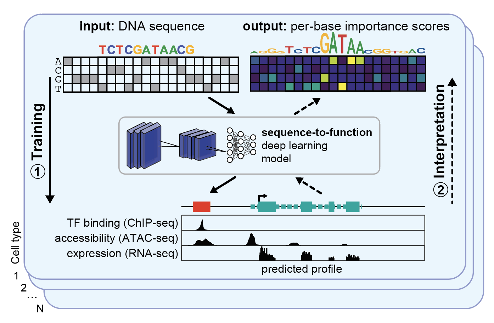
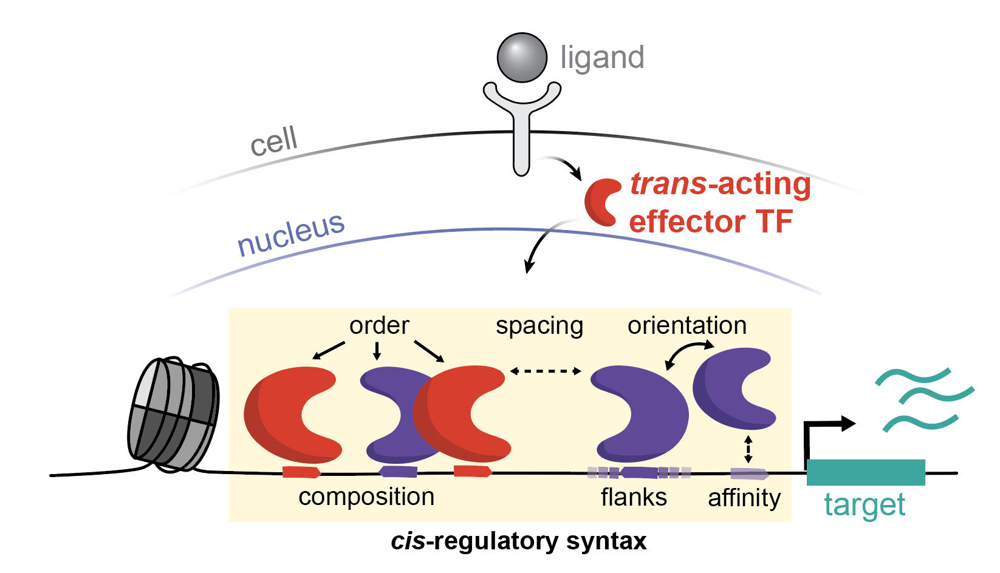
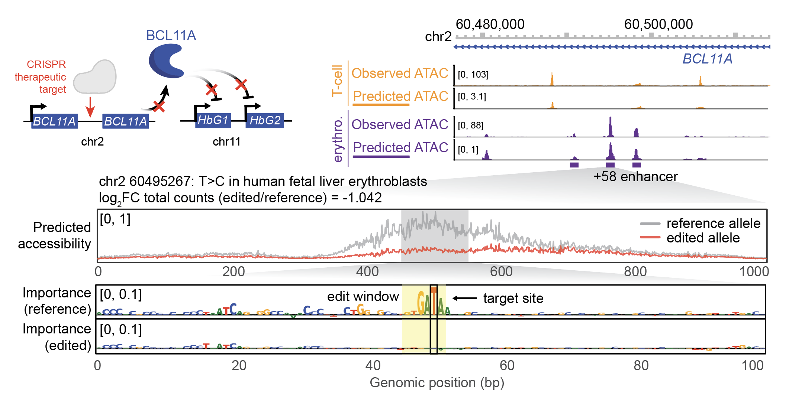

# Research
{: .page-title}

We are interested in fundamental mechanisms of cis-regulation, which control gene expression at the right time, place, and quantity. We're particularly interested in how gene regulatory programs are established during development, how they're disrupted in disease, and how they can be engineered or targeted for therapeutics.
To answer these questions, we combine functional genomics data analysis with state-of-the-art interpretable deep learning models to use DNA sequence (As, Cs, Gs, and Ts) to predict these readouts - and then we interpret these models to understand what they learned.

{: .research-hero-img }

## How does cis-regulatory logic allow cells to activate cell type-specific gene expression programs from common developmental cues?

During development, cells use external signals and intrinsic regulatory factors to activate transcription of the right genes at the right time and place. Remarkably, all the cell types in the human body reuse approximately a dozen developmental signaling pathways, which terminate in binding of DNA sequence-specific transcription factors (TFs) in cis-regulatory elements (CREs) in the regulatory genome. How do cells achieve cell type-specific responses to these common cues? We'll study the cis-regulatory logic that mediates cell signaling responses - and
understand how organization or “syntax” of TF binding sites (composition, order, spacing, orientation, flanks, affinity) in CREs enables integration of inputs and cell type-specific responses to signaling pathways. 

Representative publications:
- [Multiomics and deep learning dissect regulatory syntax in human development](https://www.nature.com/articles/s41586-026-10326-9), Liu`*`, Jessa`*` et al, _Nature_, 2026.

## How is cis-regulatory logic disrupted in disease, and how can it be programmed to design gene therapies?

Changes to the DNA sequence in cis-regulatory elements can change the cell context, quantity, and timing of gene expression. We use deep learning models trained in disease and developmentally-relevant tissues to predict and understand effects of non-coding variants in disease. In turn, we these models to design sequences and sequence changes to alter or program gene regulation for therapeutic applications.

Representative publications:
- [Multiomics and deep learning dissect regulatory syntax in human development](https://www.nature.com/articles/s41586-026-10326-9), Liu`*`, Jessa`*` et al, _Nature_, 2026
- [Sensitive, direct detection of non-coding off-target base editor unwinding and editing in primary cells](https://www.biorxiv.org/content/10.1101/2025.09.25.678665v1), Wang, Jessa et al, _bioRxiv_, 2025.
